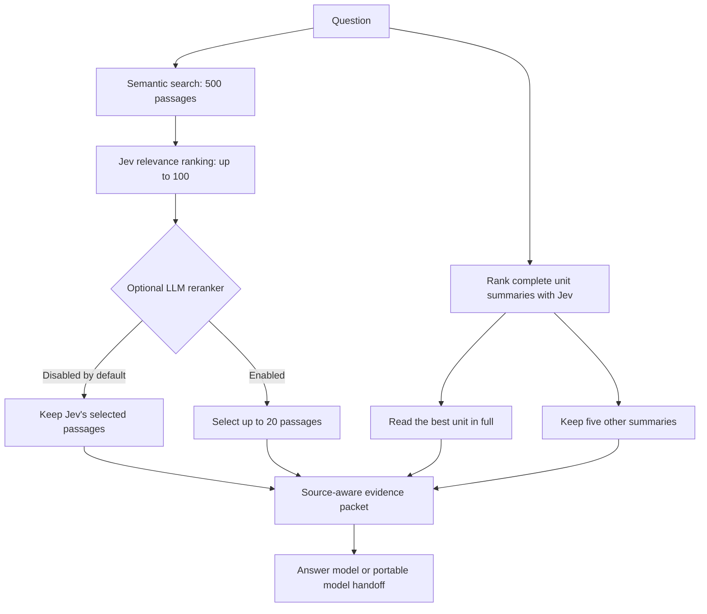

# Mori

### RAG with whole-source context

Mori combines precise passages with the arguments they came from. It retrieves embedded text, ranks relevance with Jev, and builds an answer packet containing a complete source unit, summaries of other sources, and selected passages. An additional LLM reranker is available, but disabled by default.

Books, articles, lectures and podcasts share the same contract: a source contains readable **units**, each unit has a complete original and a faithful summary, and passages retain their exact position inside that unit.




## Why this design

A passage can answer a narrow question while hiding the qualifications around it. A summary helps find the right source, but cannot replace reading its argument. Mori keeps three evidence levels distinct:

| Evidence | Purpose | Default |
|---|---|---:|
| Complete source unit | Preserve the leading argument and its qualifications | 1 |
| Summaries of other units | Broaden coverage without pretending those originals were read | 5 |
| Original passages | Supply specific evidence from the remaining sources | Up to 100 |

Passages from units already included in full are excluded by default. Summary selections are distinct and exclude the full units. If the collection is small or too little evidence meets the relevance threshold, the packet reports the shortfall. It never pads results with duplicates or invents sources.

Identical passages from different units keep their separate attribution and context. Source metadata, including authorship and extraction caveats, accompanies the evidence in both the saved packet and the model handoff.

The goal is better contextual evidence, not an unsupported claim to be the best system on every benchmark. Quality depends on unit boundaries, summaries, retrieval coverage, the rubric and the answer model. See [evaluation](docs/EVALUATION.md) for what is and is not tested.

## Quick start

Requires Python 3.11 or newer. From a source checkout:

```sh
python -m venv .venv
# Activate the environment for your operating system.
python -m pip install -e ".[local]"
python -m mori --config examples/mori.toml ingest examples/corpus.jsonl
python -m mori --config examples/mori.toml status
python -m mori --config examples/mori.toml plan
```

The first local embedding operation downloads the selected model to the standard model cache. The core has no required third-party Python dependencies; the `local` extra installs Sentence Transformers and its runtime. Existing ONNX models and compatible HTTP embedding servers are also supported. [Provider setup](docs/PROVIDERS.md)

Set your Jev credential on the server:

```sh
# macOS / Linux
export TYPESAFE_API_KEY="your-key"

# PowerShell
$env:TYPESAFE_API_KEY = "your-key"
```

Build an evidence packet, without calling a final answer model:

```sh
python -m mori --config examples/mori.toml query "Why do the fictional Northbridge notes prefer wetland restoration, and when are walls still needed?"
python -m mori --config examples/mori.toml serve
```

Open **http://127.0.0.1:8840**. Upload source units, adjust counts and context options, review the call budget, inspect source evidence, download a packet, or answer with your configured model. The interface is local-only; credentials stay on the server. The supplied Northbridge corpus is an explicitly fictional, redistributable teaching example.

The repository is installed from source; the package is not claimed to be published to PyPI. A network-free installation/test of the core is `python -m pip install -e .` followed by the test command below. `examples/demo.toml` uses explicitly labelled lexical hash vectors for fixtures, not semantic search.

## Choose your embeddings

Mori offers two explicit starting presets:

| Choice | Model | Intended tradeoff |
|---|---|---|
| **MiniLM: speed first** | `all-MiniLM-L6-v2`, 384 dimensions, local | Lightweight, typically faster for local use, no embedding API bill; a smaller model with lower expected retrieval quality on demanding collections. |
| **OpenAI: quality first** | `text-embedding-3-large`, 3,072 dimensions by default | Higher-quality hosted option, particularly worth evaluating for difficult or multilingual retrieval; requires API access, has usage cost and network latency. |

This is a practical selection guide, not a measured MiniLM-versus-OpenAI benchmark for your corpus. Hardware, batching, network and the question set can change both speed and quality. [MiniLM model card](https://huggingface.co/sentence-transformers/all-MiniLM-L6-v2) · [OpenAI embeddings guide](https://developers.openai.com/api/docs/guides/embeddings)

```sh
# Create one of these configurations, then use it consistently for ingestion and queries:
python -m mori init --embeddings minilm --output minilm.toml
python -m mori init --embeddings openai --output openai.toml

python -m mori --config minilm.toml --data .mori-minilm ingest examples/corpus.jsonl
# Set OPENAI_API_KEY before the hosted option:
python -m mori --config openai.toml --data .mori-openai ingest examples/corpus.jsonl
```

The choice applies to **both corpus and query embeddings**. Switching models requires an explicit re-embedding into a separate index; vectors are never mixed. OpenAI embedding API access is separate from the Codex SDK answer-provider login. You can still use Codex for answers with either embedding option.

## Source and unit contract

A **source** is a work: a book, video, article or podcast series. A **unit** is the complete piece it is reasonable to read together: a chapter, lecture, article or episode. A **chunk** is only a retrieval window inside a unit.

```json
{
  "id": "book-a:chapter-03:v1",
  "source_id": "book-a",
  "title": "Chapter 3: Attention and practice",
  "kind": "chapter",
  "locator": "Chapter 3, pages 41–58",
  "text": "The complete original chapter text...",
  "summary": "A faithful summary of the whole chapter...",
  "metadata": {"author": "Author name", "license": "Your source's actual license"}
}
```

Put one JSON object per line in a `.jsonl` file. Metadata can carry authors, dates, URLs, timestamps, collections, access conditions and extraction limitations. Import from any database by exporting this contract; the engine has no topic-specific schema.

```sh
python -m mori ingest my-units.jsonl
# Generate missing summaries with a configured answer provider:
python -m mori --config my-config.toml ingest lecture.txt --summarize
python -m mori --config my-config.toml ingest book.md --split headings --summarize
# Fetch a specific public HTTPS article snapshot (not an unrestricted crawler):
python -m mori --config my-config.toml fetch https://example.org/article --summarize
```

Text, Markdown, HTML, VTT/SRT transcripts and DOCX are supported. PDF text extraction is optional: `python -m pip install -e ".[pdf]"`. Scanned documents need reviewed OCR. Audio/video needs a transcript before ingestion; the agent guide explains how to attach episode/time provenance rather than claiming an HTML page is a transcript.

[Unit design](docs/UNITS.md) · [Database and source adapters](docs/ADAPTERS.md) · [Agent integration instructions](AGENTS.md)

## Relevance that remains interpretable

Jev evaluates every candidate against the **original question**. The default uses ten ordered qualitative descriptions, from unrelated to an exact substantive match. The API's fractional expected rubric position is normalized to **0–100 relevance points**:

```text
relevance = 100 × expected_rubric_position / (number_of_levels − 1)
```

For example, on the ten-level rubric, a returned score of 7.7 becomes approximately 85.56 relevance points. The full probability distribution, modal label, returned confidence, requested model and resolved model are retained. This is not an 85.56% probability that a claim is true, nor 100 independently classified levels. Jev supports 2–10 ordered score levels; the default deliberately stays inside that contract. [TypeSafe decision reference](https://docs.typesafe.ai/)

You may replace the rubric with 2–10 ordered descriptions for your domain. Thresholds filter the normalized scale, while ranking uses that scale followed by semantic similarity and a stable ID. The entire rubric and configuration are saved with each inquiry. See [customization](docs/CUSTOMIZATION.md) for the anchor ranges and settings.

## Change the pipeline without changing the engine

All settings live in TOML. The browser exposes the frequently changed evidence settings; provider endpoints and commands remain server-side configuration.

```toml
retrieval_k = 500
jev_k = 100
final_passages = 100
full_units = 1
summaries = 5
min_relevance = 40.0
summary_min_relevance = 40.0
summary_candidates = 0       # score every complete summary
rerank_enabled = false
rerank_k = 20
rating_neighbors = 0         # additional same-unit chunks shown to Jev
answer_neighbors = 0         # additional same-unit chunks in the answer packet
exclude_full_unit_passages = true
```

Want **one complete chapter, five summaries and twenty passages without another reranker**? Set `final_passages = 20`. Want a heavier model to curate the Jev shortlist? Set `rerank_enabled = true`. Neighbor context before relevance scoring and in the final answer are separate switches.

By default, all summaries are scored directly. For a larger corpus, set `summary_candidates` to preselect a smaller summary pool semantically before Jev, and evaluate the recall tradeoff. A preflight call budget prevents unexpectedly rating an entire large collection.

For an explicit passage-only query, set both `full_units = 0` and `summaries = 0`; summary rating and its call budget are then skipped. Only the active final-passage cap constrains the shortlist. Answering or reranking without a configured LLM fails before any retrieval or relevance calls.

## Answer providers

You can use a compatible chat-completion endpoint, a trusted local command, or the portable `answer_prompt.txt` handoff with any LLM. No answer provider is silently selected. Summary generation, optional reranking and answering use the same configured LLM adapter; advanced integrations can inject separate adapters for each task.

The optional [Codex SDK bridge](adapters/codex/bridge.mjs) uses a separately authenticated local Codex installation. It requires Node.js and the official SDK:

```sh
cd adapters/codex
npm ci --ignore-scripts
cd ../..
python -m mori --config examples/codex.toml query "Your question" --answer
```

The bridge is optional, model-configurable and runs in a fresh read-only working directory with network/web access disabled. Provider access, billing, context limits and usage terms remain the user's responsibility. [Official Codex SDK documentation](https://developers.openai.com/codex/sdk)

## Reproducible evidence

Each query writes an immutable run directory under your data directory:

```text
request.json             Original question, settings, rubric, model fingerprint and budget
retrieved.json           Semantic candidates and source identities
passage_ratings.json     Jev passage ranking and distributions
summary_ratings.json     Independent summary ranking
context.json             Structured complete-unit / summary / passage evidence
context.md               Readable evidence packet
answer_prompt.txt        Exact portable final-model handoff
answer.md                Optional validated answer
status.json              Completion or explicit failure
```

Successful Jev decisions are cached by exact question, evidence, rubric, endpoint and model request. Interrupted queries reuse completed decisions on an explicit retry. Sources are immutable by ID; changed text or summaries require a new version. Query and ingestion model fingerprints must match.

Known citation groups/ranges are normalized to individually linked evidence IDs, with locator notes retained and the original response saved as `answer.raw.md`. Unknown or malformed references still fail validation. A failed run preserves the candidate as `answer.rejected.md` for local diagnosis and never presents it as the validated `answer.md`. Older ONNX indexes need rebuilding after the tokenizer truncation fix; see [provider compatibility](docs/PROVIDERS.md#existing-onnx-model).

The context budget is enforced on the full rendered packet. A full chapter that does not fit causes an explicit error; Mori does not quietly clip it. Character budgets are conservative application controls, not exact model token counts. Configure them to fit the model actually used.

## Tests and limitations

```sh
python -m unittest discover -s tests -v
node --check mori/static/app.js
```

Behavioral tests cover the 500 → 100 → 20 flow, disabled-stage behavior, source exclusion, exact offsets, source versions, neighbor boundaries, malformed model output, citation IDs, caching and overflow handling. The local reference store uses SQLite and exact cosine search. It is intended for modest collections, not a claimed million-document vector service. Replace storage/search behind the adapter contract when scale requires it.

Citation validation checks that cited evidence exists. It cannot prove entailment, philosophical accuracy, OCR fidelity or complete recall. Summaries can omit relevant arguments. Prompt instructions reduce some risks but cannot guarantee resistance to prompt injection. [Security and data handling](docs/SECURITY.md) · [Evaluation](docs/EVALUATION.md)

## Contributing

Keep source units, summaries and passage identity separate. Add providers or storage adapters through explicit interfaces, preserve failure visibility, and include behavioral tests. Do not add private corpora or credentials to examples. See [CONTRIBUTING.md](CONTRIBUTING.md) and [AGENTS.md](AGENTS.md).

## License

[MIT](LICENSE). The license covers Mori's code and original example fixtures. Imported works and third-party models retain their own licenses. Mori includes no bundled private corpus or model weights.
